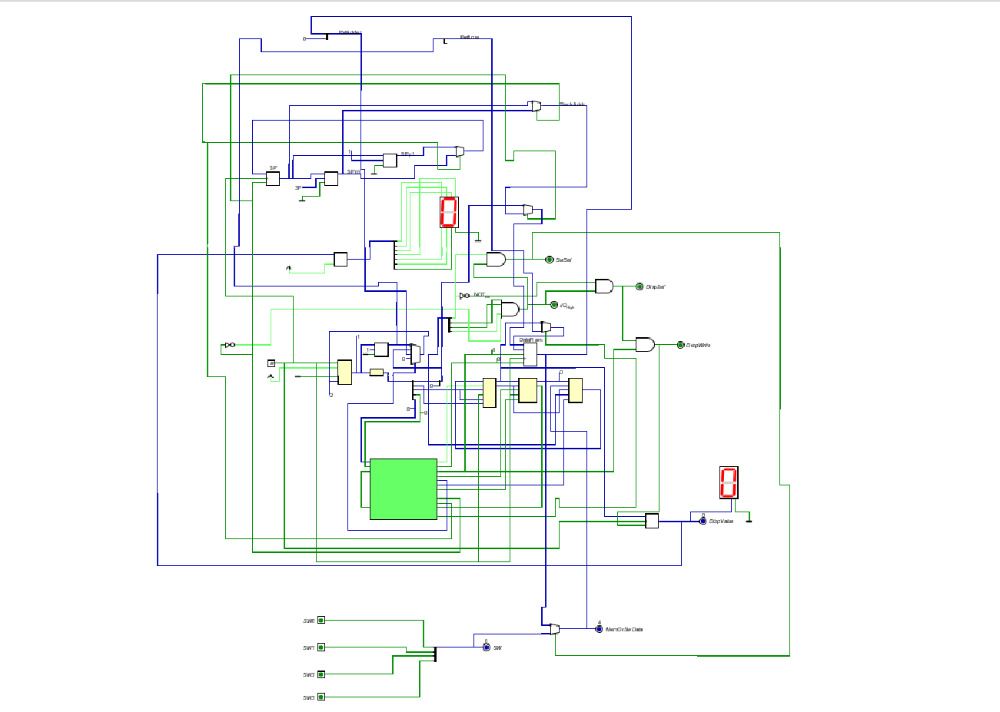

# Computer Architecture and Organization

A collection of laboratory exercises from the **Computer Architecture and Organization** course at **King Mongkut's Institute of Technology Ladkrabang (KMITL)**.

This repository explores the fundamentals of computer architecture through hands-on digital logic design, circuit simulation, and CPU development.

## Overview

The laboratory exercises focus on understanding how a CPU operates at the hardware level by designing and integrating fundamental digital components.

**Key Concepts:**
- Digital logic gates and combinational circuits
- Arithmetic Logic Unit (ALU)
- Registers and sequential circuits
- Datapath design
- Control logic and CPU organization
- CPU component integration

## CPU Design

The CPU circuit is designed and simulated using **Digital**, demonstrating the organization and interaction of hardware components within a processor.

  

  <em>CPU architecture designed using Digital</em>

## Tools & Technologies

### Digital — Logic Circuit Simulator

[Digital by Helmut Neemann](https://github.com/hneemann/Digital)

An open-source digital logic designer and circuit simulator used to create, simulate, and test digital circuits.

**Features:**
- Graphical circuit design and simulation
- Combinational and sequential logic circuits
- Reusable circuit components
- Signal visualization and circuit testing
- CPU architecture design and simulation

## Learning Objectives

- Understand CPU architecture and internal hardware organization.
- Design and simulate digital logic circuits.
- Explore datapath and control logic.
- Develop practical knowledge of how CPU components interact.

## Acknowledgment

Developed as part of the **Computer Architecture and Organization** laboratory coursework at **King Mongkut's Institute of Technology Ladkrabang (KMITL)**.

## Author

**San Win**  
Software Engineering Student — KMITL, Thailand

---

*Computer Architecture • Digital Logic • CPU Design*
